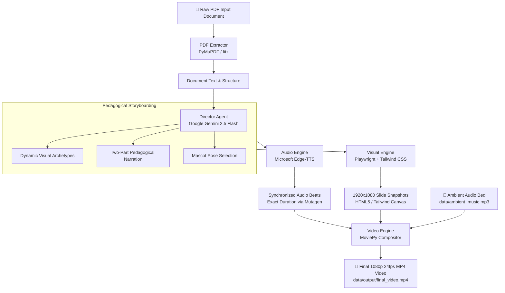

# Autonomous PDF-to-Video Engine 🎬

[](https://www.python.org/)
[](https://streamlit.io/)
[](https://playwright.dev/)
[](https://ai.google.dev/)
[](https://www.docker.com/)

An autonomous multimodal AI production engine that transforms static, academic, or technical PDF documents into high-retention, masterclass-quality **16:9 explainer videos** with neural voiceovers, dynamic pedagogical visual archetypes, and an expressive mascot host.

---

## 🌟 Overview

Technical documents, research whitepapers, and academic PDFs often contain dense information that is hard to digest. The **Autonomous PDF-to-Video Engine** automatically reads arbitrary PDF documents, extracts pedagogical beats, generates structured two-part educational scripts, renders high-resolution widescreen canvas frames, synthesizes neural voiceover audio, and stitches a cinematic 1080p MP4 complete with subtle Ken Burns motion and ambient background audio.

---

## 🏗️ System Architecture



---

## 🚀 Core Features

- **Topic-Agnostic Generation**: Zero hardcoded assumptions. Automatically adapts visual archetypes, codes, pipelines, and analogies to any uploaded document (Artificial Intelligence, Cloud Infrastructure, Molecular Biology, Quantitative Finance, History, Physics, etc.).
- **Strict 2-Column Explainer Canvas**:
  - **Left Column (55% width - Content Stage)**: Topic badge, punchy main headline, gradient divider, high-contrast key takeaways, and glowing bottom caption pill.
  - **Right Column (45% width - Visual Stage)**: Dedicated framed canvas rendering dynamic visual archetypes paired with an expressive mascot host.
- **Dynamic Visual Archetypes**:
  - **Comparison Matrix**: 2x2 grid of color-coded cards (`cyan`, `emerald`, `amber`, `rose`, `purple`, `blue`) with badges and descriptions.
  - **Pipeline Flow**: 3-step vertical process diagrams with stage tags and glowing directional connectors.
  - **Code Window**: Dark macOS-style terminal with traffic-light window controls, filename tabs, syntax-highlighted code, and execution status labels.
  - **Metaphor Illustration**: Side-by-side comparison cards balancing intuitive real-world analogies with technical system realities.
- **Expressive Mascot Host**: 5 distinct mascot poses (`pointing_stick`, `thinking`, `explaining`, `shrugging`, `arms_crossed`) positioned with zero overlap or layout collision.
- **Two-Part Pedagogical Narration**:
  1. **Part 1 (Anchor)**: Reads the on-screen headline and points verbatim so the audience immediately connects what they see with what they hear.
  2. **Part 2 (Intuition)**: Transitions into a conversational, teacher-style breakdown featuring intuition and real-world parallels.
- **Cinematic Video Assembly**: 2% centered Ken Burns zoom per beat, immediate clean cuts between scenes, 6% volume looped ambient background music, rendered at 1080p 24 FPS.
- **Modern Dark-Mode Web Application**: Built with Streamlit (`#060913` dark theme, cyan/blue glow), real-time phase progress tracking, built-in 1080p video player, instant download button, and an interactive storyboard breakdown viewer.
- **Full CLI Support**: Automate batch processing from terminal commands or headless scripts.

---

## 🛠️ Tech Stack

| Component | Technology | Purpose |
| :--- | :--- | :--- |
| **Language** | Python 3.11+ | Core runtime and engine logic |
| **LLM Director** | Google Gemini 2.5 Flash | Pedagogical analysis, structured storyboarding & script generation |
| **Document Parsing** | PyMuPDF (`fitz`) | High-fidelity text extraction from PDF pages |
| **Visual Rendering** | Playwright + Chromium | Headless browser rendering of 1920x1080 HTML5/Tailwind layouts |
| **Voice Synthesis** | Microsoft Edge-TTS | High-fidelity neural text-to-speech with multiple natural voices |
| **Audio Analysis** | Mutagen | Sub-millisecond MP3 audio duration measurement for timeline sync |
| **Video Compositing** | MoviePy (`<2.0.0`) | Ken Burns motion, beat concatenation, and audio track mixing |
| **Web UI** | Streamlit (`>=1.30.0`) | Modern dark-mode browser interface with real-time pipeline status |
| **Containerization** | Docker | Production container image with pre-installed Chromium and ffmpeg |

---

## 📦 Local Setup & Installation

### Prerequisites

- **Python 3.11+** installed on your system.
- **ffmpeg** installed and available in your system `PATH` (required for MoviePy video encoding).

### 1. Clone the Repository

```bash
git clone https://github.com/sevda-saurav/pdf-to-video-engine.git
cd pdf-to-video-engine
```

### 2. Create and Activate Virtual Environment

```bash
# Windows (PowerShell)
python -m venv .venv
.\.venv\Scripts\Activate.ps1

# Linux / macOS
python3 -m venv .venv
source .venv/bin/activate
```

### 3. Install Dependencies

```bash
pip install --upgrade pip
pip install -r requirements.txt
```

### 4. Install Playwright Chromium

```bash
playwright install chromium
```
*(On Linux, run `playwright install chromium --with-deps` to install required OS libraries).*

### 5. Configure Environment Variables

Create a `.env` file in the project root directory:

```env
# Gemini API Key (or OpenAI API Key if using compatible gateway)
GEMINI_API_KEY=your_gemini_api_key_here

# Optional: Custom Gemini Model or Base URL (defaults to Gemini 2.5 Flash)
GEMINI_BASE_URL=https://generativelanguage.googleapis.com/v1beta/openai/
GEMINI_MODEL=gemini-2.5-flash
```

---

## 🖥️ Usage

### Option A: Launch the Streamlit Web Application

Start the interactive dark-mode dashboard:

```bash
streamlit run app.py
```

Open your browser at `http://localhost:8501`.

1. **Upload PDF**: Drag & drop any PDF document (or use the bundled `sample.pdf`).
2. **Choose Voice**: Select from neural voices:
   - `Christopher (US Male - Professional)`
   - `Jenny (US Female - Natural)`
   - `Guy (US Male - Casual)`
   - `Sonia (UK Female - Clear)`
3. **Configure Scene Count**: Choose between 3 and 6 storytelling beats (default: 5).
4. **Click "Generate Video"**: Watch the 4-phase execution progress bar in real time.
5. **Watch & Download**: Stream the generated 1080p MP4 directly in the browser and download with one click.
6. **Inspect Storyboard**: Expand the Storyboard Breakdown section to review individual beat cards, code snippets, visual components, and voiceover scripts.

---

### Option B: Command-Line Interface (CLI)

Run the autonomous synthesis pipeline directly via `main.py`:

```bash
python main.py --input data/input/sample.pdf --output data/output/final_video.mp4 --beats 5 --voice en-US-ChristopherNeural
```

#### CLI Options:

| Flag | Argument | Default | Description |
| :--- | :--- | :--- | :--- |
| `-i`, `--input` | `PATH` | `data/input/sample.pdf` | Path to the source PDF file |
| `-o`, `--output` | `PATH` | `data/output/final_video.mp4` | Path for the rendered MP4 video |
| `-v`, `--voice` | `STRING` | `en-US-ChristopherNeural` | Edge-TTS neural voice identifier |
| `-b`, `--beats` | `INT` | `5` | Number of educational beats to generate |
| `--bg-music` | `PATH` | `data/ambient_music.mp3` | Ambient music file mixed into video audio |
| `--temp-dir` | `PATH` | `data/temp` | Directory for cached frames and beat audio |

---

## 🐳 Docker & Cloud Deployment

### 1. Build and Run Locally with Docker

Build the production container image:

```bash
docker build -t pdf-to-video-engine .
```

Run the container with your `.env` configuration:

```bash
docker run -d -p 8501:8501 --env-file .env --name pdf-video-app pdf-to-video-engine
```

Visit `http://localhost:8501` in your browser.

---

### 2. Cloud Deployment Guidelines

#### **Railway**
1. Connect your GitHub repository to Railway.
2. Select **Deploy from Dockerfile**.
3. In the Railway project settings, configure environment variable:
   - `GEMINI_API_KEY`: `your_api_key_value`
4. Set the networking port to `8501`.

#### **Hugging Face Spaces**
1. Create a new Space and select **Docker** as the SDK.
2. Push your repository to the Hugging Face Space remote.
3. In Space Settings $\rightarrow$ **Repository Secrets**, add `GEMINI_API_KEY`.
4. Hugging Face Spaces exposes port `7860` or `8501` automatically based on the Dockerfile.

#### **Render**
1. Create a **Web Service** from your GitHub repo.
2. Choose **Docker** environment.
3. Add environment variable `GEMINI_API_KEY` under Environment.
4. Set Health Check path to `/` and port to `8501`.

---

## 📁 Repository Structure

```
pdf_to_video/
├── .streamlit/
│   └── config.toml             # Streamlit dark theme configuration
├── assets/                     # Mascot host character sprites
│   ├── arms_crossed.png
│   ├── explaining.png
│   ├── pointing_stick.png
│   ├── shrugging.png
│   └── thinking.png
├── data/
│   ├── ambient_music.mp3       # Ambient background soundtrack
│   ├── input/
│   │   └── sample.pdf          # Sample technical document
│   ├── output/
│   │   ├── final_video.mp4     # Generated MP4 video
│   │   └── storyboard.json     # Saved storyboard metadata
│   └── temp/                   # Cached audio and frame slides
├── src/
│   ├── audio_engine.py         # Edge-TTS voiceover synthesis & padding
│   ├── config.py               # Gemini API and model configuration
│   ├── director.py             # Gemini 2.5 Flash pedagogical storyboarding
│   ├── extractor.py            # PyMuPDF document text extraction
│   ├── schemas.py              # Pydantic schemas (VisualCard, Beat, Storyboard)
│   ├── video_engine.py         # MoviePy Ken Burns zoom & timeline stitching
│   └── visual_engine.py        # Playwright 16:9 canvas HTML/Tailwind rendering
├── app.py                      # Streamlit dark-mode web application
├── main.py                     # CLI pipeline entry point
├── Dockerfile                  # Production container configuration
├── .dockerignore               # Docker build exclusions
├── .gitignore                  # Git repository exclusions
├── requirements.txt            # Production Python dependencies
└── README.md                   # Project documentation
```

---

## 📄 License

This project is open-source under the [MIT License](LICENSE).
